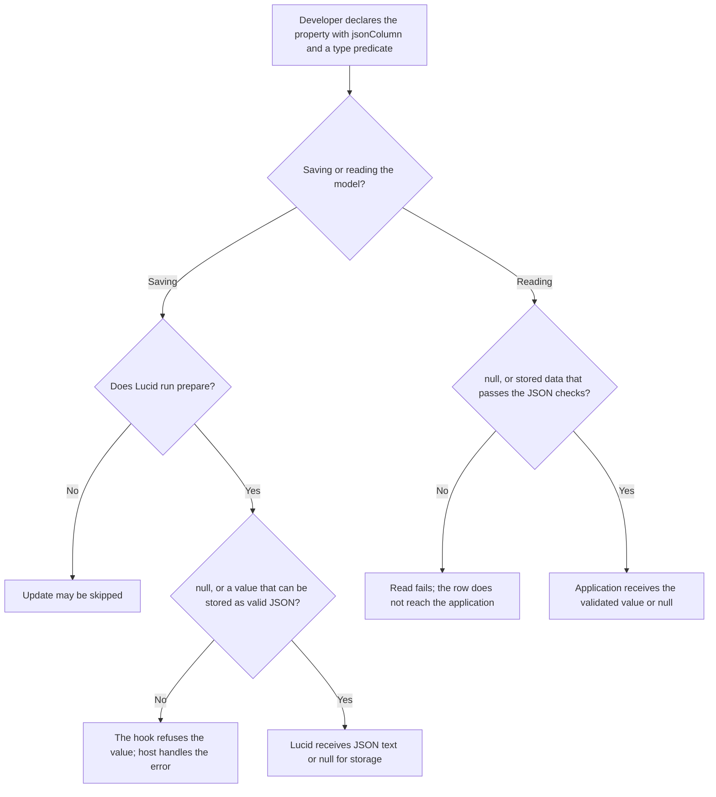
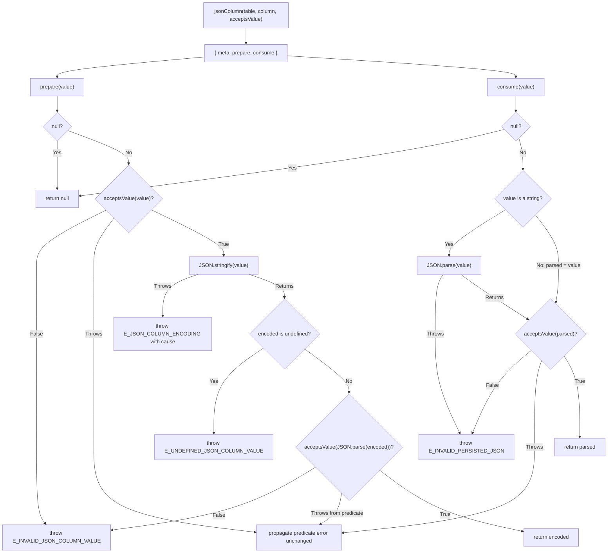

# US-COLUMN-01 — Store a checked JSON property

As an application developer, I want a model property stored as JSON and checked against a type predicate when it is written and when it is read so that an invalid value is refused when Lucid runs its column hooks and a corrupt row fails hydration instead of reaching the application.

**Status:** Current.
**Access:** Application developer who declares the Lucid model. Applies to model saves and model hydration only.
**Entry:** `@column(jsonColumn(table, column, acceptsValue))` on a Lucid model property, with a type predicate such as `isBoolean`, one returned by `isOneOf(values)` or `isArrayOf(acceptsValue)`, or any host type predicate.
**Documentation:** [Use](../README.md#use), [API](../README.md#api), [Errors](../README.md#errors), [Limits](../README.md#limits).
**Source:** [JSON column](../src/json_column.ts).
**Coverage:** [JSON column tests](../tests/json_column.spec.ts).

## Acceptance criteria

| Input          | Control    | Required/default/conditions                                                                                                                                                                                                                                                                                          |
| -------------- | ---------- | -------------------------------------------------------------------------------------------------------------------------------------------------------------------------------------------------------------------------------------------------------------------------------------------------------------------- |
| `table`        | Argument 1 | Required string. Table name exposed on exceptions and in their diagnostics.                                                                                                                                                                                                                                          |
| `column`       | Argument 2 | Required string. Column name exposed on exceptions and in their diagnostics.                                                                                                                                                                                                                                         |
| `acceptsValue` | Argument 3 | Required TypeScript type predicate `(value: unknown) => value is T`. Use `isBoolean` for booleans, the type predicate returned by `isOneOf(values)` for listed strings or numbers, the one returned by `isArrayOf(acceptsValue)` to apply another type predicate to every array element, or your own type predicate. |

- On save, an accepted non-null value is written as `JSON.stringify(value)`. On read, every string is parsed with `JSON.parse`; a non-string value from the driver is validated as it is. A direct `null` input passes through either hook without validation; JSON text `null` is parsed and validated like other text.
- The stored representation is JSON text, suitable for a text column. A decoded native scalar string is not supported: strings are always parsed as JSON, with no parse-error fallback. The packed consumer verifies SQLite text storage; other driver encodings are not claimed.
- On save, a non-null value must pass `acceptsValue` both before encoding and after its JSON text is parsed back, so under unchanged host validation rules whatever is written can be read back. If either check fails, the save throws `errors.E_INVALID_JSON_COLUMN_VALUE` before the hook returns a value for the model write. Read-side validation still runs for every read.
- After a value passes `acceptsValue`, an encoding that returns `undefined` (a function, for example) throws `errors.E_UNDEFINED_JSON_COLUMN_VALUE`, and an encoding that throws (a `BigInt` or a cycle) throws `errors.E_JSON_COLUMN_ENCODING` with the original error as `cause`.
- On read, text that is not JSON, or a decoded value that fails `acceptsValue`, throws `errors.E_INVALID_PERSISTED_JSON`; the row does not hydrate. Its parser cause and stored content are omitted. Both this exception and the write-value exception use the diagnostic `Invalid persisted JSON in <table>.<column>`; distinguish them by class or code, not message.
- Hook types accept optional `attribute` and `model` arguments, but the helper does not use them or pass them to `acceptsValue`; the predicate receives only the value. `prepare` returns text or null; `consume` returns `T` or null. Neither hook performs the database write.
- An exception thrown by the host predicate propagates unchanged during either write-side check or the read-side check. Only an exception during encoding is wrapped with a cause.
- The helper refuses an invalid value rather than repairing it; beyond JSON encoding on save and parsing on read, it changes nothing. Query-builder writes bypass it.
- Lucid can skip an update before `prepare` runs when a top-level object value owns an `isDirty: false` property. Avoid that key for top-level object values in model saves; resolving arbitrary keys requires Lucid dirty-tracking changes.

## User flow

## Code flow

Scope: the column options Lucid calls on model save (`prepare`) and hydration (`consume`); queries that bypass the model are host-owned.

**Code references:** [jsonColumn](../src/json_column.ts#L123), [type predicates](../src/json_column.ts#L53), [JsonTypePredicate](../src/types.ts#L10).
