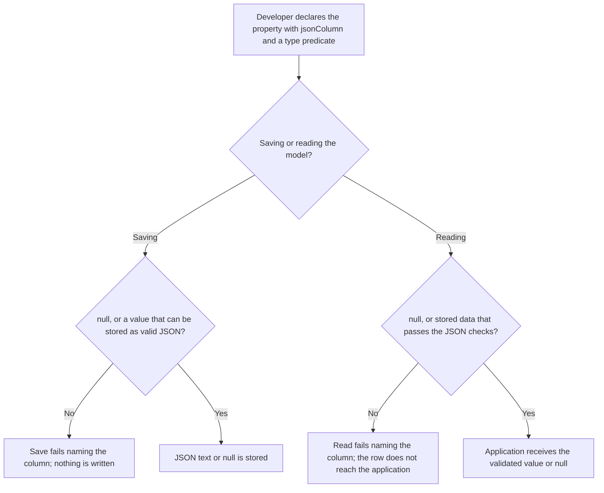
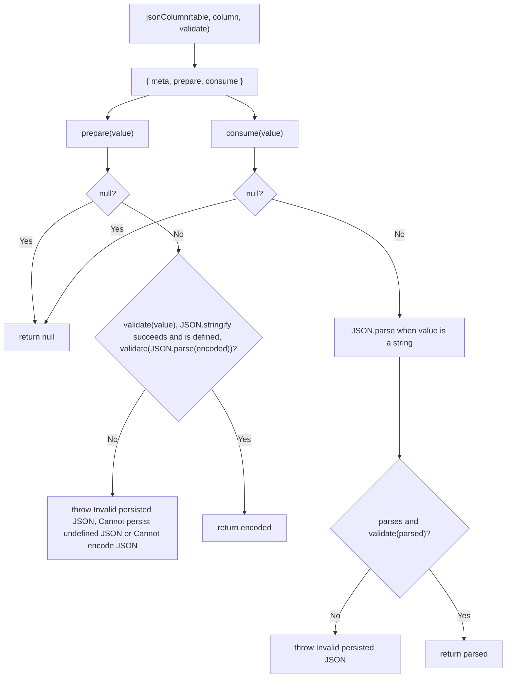

# US-COLUMN-01 — Store a checked JSON property

As an application developer, I want a model property stored as JSON and checked against a type predicate when it is written and when it is read so that an invalid value is refused when Lucid runs its column hooks and a corrupt row fails hydration instead of reaching the application.

**Status:** Current.
**Access:** Application developer who declares the Lucid model. Applies to model saves and model hydration only.
**Entry:** `@column(jsonColumn(table, column, validate))` on a Lucid model property, with a type predicate such as `isBoolean`, `isOneOf(values)`, `isArrayOf(validate)` or any host type guard.
**Documentation:** [Use](../README.md#use), [API](../README.md#api), [Errors](../README.md#errors), [Limits](../README.md#limits).
**Source:** [JSON column](../src/json_column.ts).
**Coverage:** [JSON column tests](../tests/json_column.spec.ts).

## Acceptance criteria

| Input      | Control    | Required/default/conditions                                                                                                                                                                                                                               |
| ---------- | ---------- | --------------------------------------------------------------------------------------------------------------------------------------------------------------------------------------------------------------------------------------------------------- |
| `table`    | Argument 1 | Required string. Table name used only in error messages.                                                                                                                                                                                                  |
| `column`   | Argument 2 | Required string. Column name used only in error messages.                                                                                                                                                                                                 |
| `validate` | Argument 3 | Required TypeScript type guard `(value: unknown) => value is T`. Use `isBoolean` for booleans, `isOneOf(values)` for listed strings or numbers, `isArrayOf(validate)` to apply another type predicate to every array element, or your own type predicate. |

- On save, an accepted non-null value is written as `JSON.stringify(value)`. On read, every string is parsed with `JSON.parse`; a non-string value from the driver is validated as it is. `null` passes through both ways without validation.
- The stored representation is JSON text, suitable for a text column. A decoded native scalar string is not supported: strings are always parsed as JSON, with no parse-error fallback. The packed consumer verifies SQLite text storage; other driver encodings are not claimed.
- On save, a non-null value must pass `validate` both before encoding and after its JSON text is parsed back, so under unchanged host validation rules whatever is written can be read back. If either check fails, the save throws `Invalid persisted JSON in <table>.<column>` and nothing is written. Read-side validation still runs for every read.
- After a value passes `validate`, an encoding that returns `undefined` (a function, for example) throws `Cannot persist undefined JSON in <table>.<column>`, and an encoding that throws (a `BigInt` or a cycle) throws `Cannot encode JSON in <table>.<column>` with the original error as `cause`.
- On read, text that is not JSON, or a decoded value that fails `validate`, throws `Invalid persisted JSON in <table>.<column>`; the row does not hydrate.
- The helper refuses an invalid value rather than repairing it; beyond JSON encoding on save and parsing on read, it changes nothing. Query-builder writes bypass it.

- Lucid can skip an update before `prepare` runs when a top-level object value owns an `isDirty: false` property. Avoid that key for top-level object values in model saves; resolving arbitrary keys requires Lucid dirty-tracking changes.

## User flow

## Code flow

Scope: the column options Lucid calls on model save (`prepare`) and hydration (`consume`); queries that bypass the model are host-owned.

**Code references:** [jsonColumn](../src/json_column.ts#L83), [type predicates](../src/json_column.ts#L40), [JsonValidator](../src/json_column.ts#L37).
