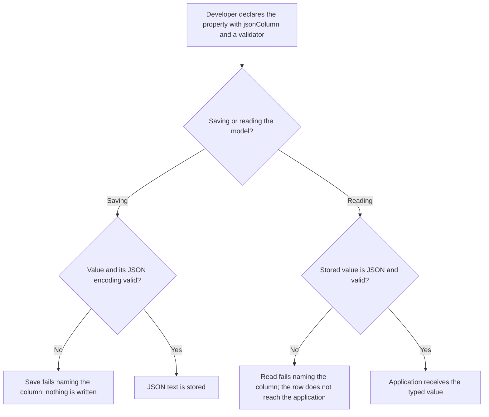
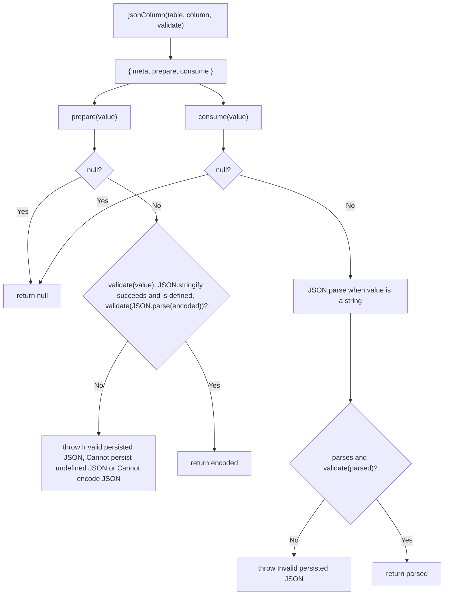

# US-COLUMN-01 — Store a checked JSON property

As an application developer, I want a model property stored as JSON and checked against a validator when it is written and when it is read so that an invalid value is never saved and a corrupt row fails loudly instead of reaching the application.

**Status:** Current.
**Access:** Application developer who declares the Lucid model. Applies to model saves and model hydration only.
**Entry:** `@column(jsonColumn(table, column, validate))` on a Lucid model property, with a validator such as `isBoolean`, `isOneOf(values)`, `isArrayOf(validate)` or any host type guard.
**Documentation:** [Use](../README.md#use), [API](../README.md#api), [Errors](../README.md#errors), [Limits](../README.md#limits).
**Source:** [JSON column](../src/json_column.ts).
**Coverage:** [JSON column tests](../tests/json_column.spec.ts).

## Acceptance criteria

| Input      | Control    | Required/default/conditions                                                                                          |
| ---------- | ---------- | -------------------------------------------------------------------------------------------------------------------- |
| `table`    | Argument 1 | Required. Names the column in error messages only.                                                                   |
| `column`   | Argument 2 | Required. Names the column in error messages only.                                                                   |
| `validate` | Argument 3 | Required. A `(value: unknown) => value is T` guard; `isBoolean`, `isOneOf` and `isArrayOf` are provided and compose. |

- On save, a valid value is written as `JSON.stringify(value)`. On read, text is parsed with `JSON.parse`; a value the driver already decoded is checked as it is. `null` passes through both ways.
- On save, the value and its JSON encoding must both pass `validate`, so whatever is written can be read back. A value or encoding that fails throws `Invalid persisted JSON in <table>.<column>` and nothing is saved.
- A value with no JSON encoding (a function, for example) throws `Cannot persist undefined JSON in <table>.<column>`. A value whose encoding throws (a `BigInt` or a cycle) throws `Cannot encode JSON in <table>.<column>` with the original error as `cause`.
- On read, text that is not JSON, or a decoded value that fails `validate`, throws `Invalid persisted JSON in <table>.<column>`; the row does not hydrate.
- The helper never repairs or converts a value. Query-builder writes bypass it.

## User flow

## Code flow

Scope: the column options Lucid calls on model save (`prepare`) and hydration (`consume`); queries that bypass the model are host-owned.

**Code references:** [jsonColumn](../src/json_column.ts#L41), [validators](../src/json_column.ts#L16), [JsonValidator](../src/json_column.ts#L13).
