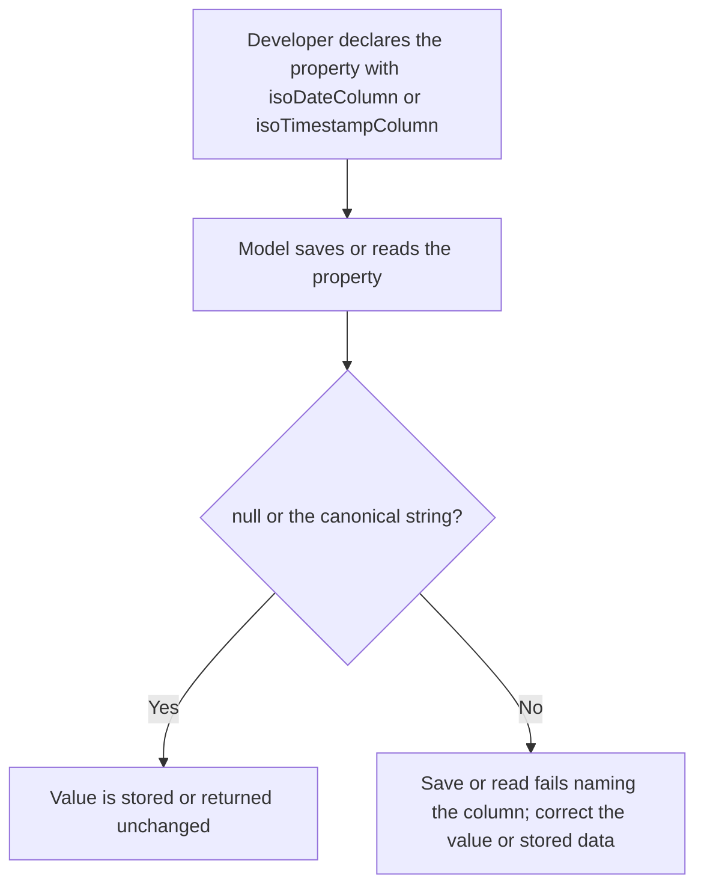
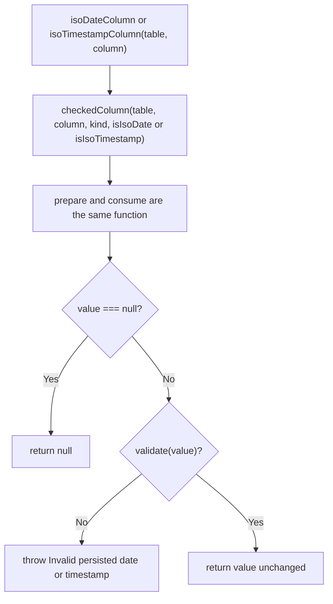

# US-COLUMN-02 — Store a checked ISO date or timestamp

As an application developer, I want a date or timestamp property kept as one canonical string in both directions so that a value in any other form is refused rather than silently converted between time zones or formats.

**Status:** Current.
**Access:** Application developer who declares the Lucid model. Applies to model saves and model hydration only.
**Entry:** `@column(isoDateColumn(table, column))` or `@column(isoTimestampColumn(table, column))` on a Lucid model property. `isIsoDate(value)` and `isIsoTimestamp(value)` return true for a string in the accepted format and false otherwise, including for `null`; the column helpers pass `null` through.
**Documentation:** [Use](../README.md#use), [API](../README.md#api), [Errors](../README.md#errors), [Limits](../README.md#limits).
**Source:** [ISO columns](../src/iso_column.ts).
**Coverage:** [ISO column tests](../tests/iso_column.spec.ts).

## Acceptance criteria

| Input    | Control        | Required/default/conditions                                                                                                        |
| -------- | -------------- | ---------------------------------------------------------------------------------------------------------------------------------- |
| `table`  | Argument 1     | Required string. Table name used only in error messages.                                                                           |
| `column` | Argument 2     | Required string. Column name used only in error messages.                                                                          |
| `T`      | Type parameter | Optional; defaults to `string`. Your TypeScript type extending `string`; it changes the property's type but adds no runtime check. |

- `isoDateColumn` accepts only a real calendar date written `YYYY-MM-DD`; month lengths and leap years are checked without depending on the host time zone.
- `isoTimestampColumn` accepts only a string `Date#toISOString()` produces: a UTC instant with three millisecond digits and a trailing `Z`.
- An accepted value is stored and returned unchanged. `null` passes through both ways.
- Any other value, including a `Date`, a Luxon `DateTime`, an instant with an offset or a non-string value from the driver, throws `Invalid persisted date in <table>.<column>` or `Invalid persisted timestamp in <table>.<column>` on save or on read. Nothing is saved, or the row does not hydrate.
- The helpers refuse an invalid value rather than repairing or converting it. Query-builder writes bypass them.

## User flow

## Code flow

Scope: the column options Lucid calls on model save and hydration; both directions share one check.

**Code references:** [isoDateColumn](../src/iso_column.ts#L55), [isoTimestampColumn](../src/iso_column.ts#L67), [isIsoDate](../src/iso_column.ts#L13), [isIsoTimestamp](../src/iso_column.ts#L29).
