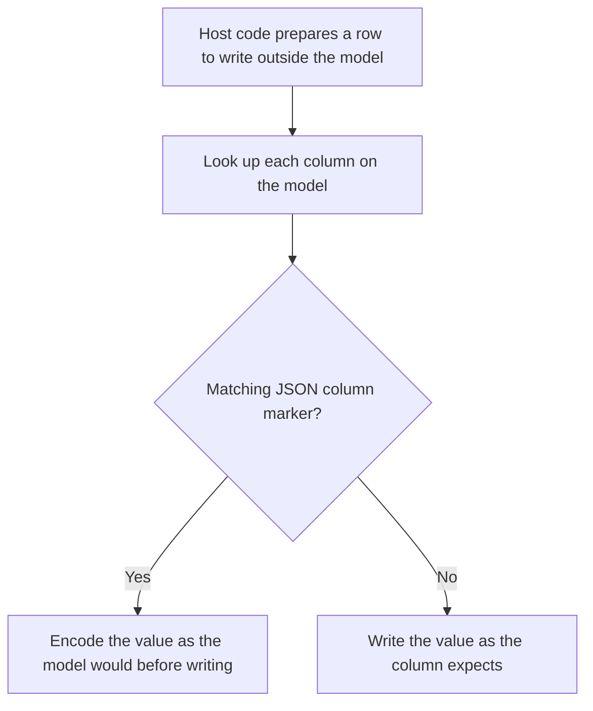
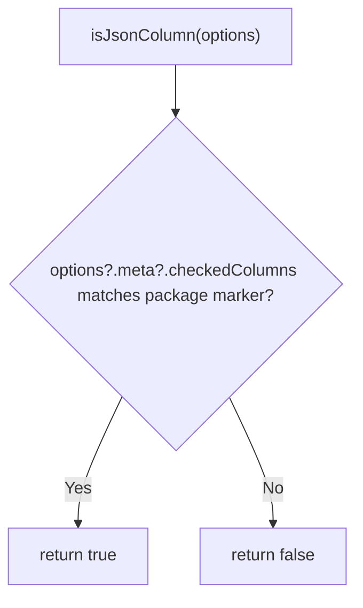

# US-COLUMN-03 — Find a model's JSON columns for writes outside the model

As an application developer, I want to tell which model columns were declared with `jsonColumn` so that code writing rows without the model, such as an import or a raw insert, can encode those columns the way the model would.

**Status:** Current.
**Access:** Application developer with access to the model class.
**Entry:** `isJsonColumn(Model.$getColumn(propertyName))`, where `propertyName` is the model property name, not the database column name.
**Documentation:** [API](../README.md#api), [Limits](../README.md#limits).
**Source:** [JSON column](../src/json_column.ts).
**Coverage:** [isJsonColumn tests](../tests/json_column.spec.ts).

## Acceptance criteria

| Input     | Control    | Required/default/conditions                                                                           |
| --------- | ---------- | ----------------------------------------------------------------------------------------------------- |
| `options` | Argument 1 | The column's options from `Model.$getColumn(propertyName)`; `undefined` (no such column) is accepted. |

- Compares the `meta.checkedColumns` string by value. Inherited declarations and options from another evaluation of the package match. Host metadata carrying the identical marker also matches.
- A plain column, a lookalike with only `meta.json: true`, or a missing property returns false.
- It reports matching metadata only, not the presence or validity of a column hook. Encoding and validating the value for a write outside the model stay with the host, which can call a JSON column's own `prepare`.

## User flow

## Code flow

Scope: package declaration check; the write itself is host-owned.

**Code references:** [isJsonColumn](../src/json_column.ts#L185), [JSON_COLUMN marker](../src/json_column.ts#L13).
