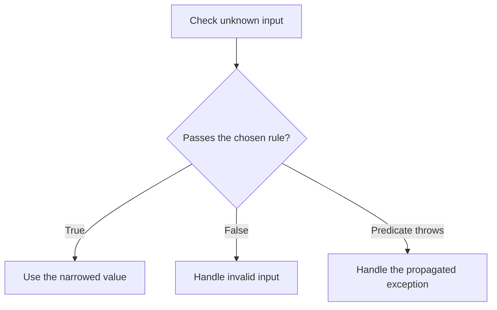
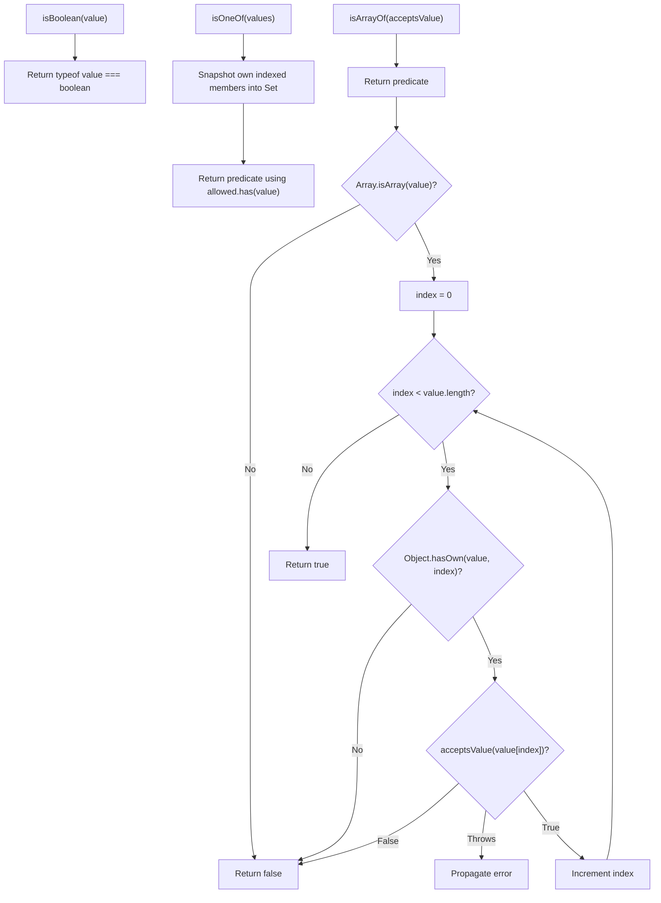

# US-COLUMN-04 — Validate unknown input with reusable JSON predicates

As an application developer, I want to check input before assigning it to a model and reuse that check on hydration so both entry points enforce the same rule.

**Status:** Current.
**Access:** Application developer. Direct calls require no Lucid model.
**Entry:** Import `isBoolean`, `isOneOf` and `isArrayOf` from the package root. Call `isBoolean(value)` directly, or call the type predicate that `isOneOf(values)` or `isArrayOf(acceptsValue)` returns.
**Documentation:** [API](../README.md#api), [Errors](../README.md#errors).
**Source:** [Type predicates](../src/json_column.ts), [JsonValidator](../src/types.ts).
**Coverage:** [Runtime and type-level cases](../tests/json_column.spec.ts).

## Acceptance criteria

- `isBoolean` accepts only the primitive values `true` and `false`.
- `isOneOf(values)` snapshots the supplied string and number members. Changing the original list afterwards has no effect. Holes add no member, an empty list accepts nothing and a numeric member never matches its string spelling.
- A readonly tuple of literal members with unchanged contents narrows to its union. A mutable tuple, a dynamic list, a union of alternative tuples, a partially known tuple or a patterned string member only establishes validated membership. Rejection of such a value leaves other values of its underlying type possible.
- `isArrayOf(acceptsValue)` accepts an empty array or an array with an own element at every index that passes the element predicate. A hole, inherited-only index, failing element or non-array returns false. The array predicate stops at the first failure. Nested predicates apply these rules at each depth.
- A successful array check narrows to the validated dense array type. A failed check leaves ordinary arrays possible. The corresponding JSON column accepts ordinary typed arrays as write inputs and checks them at runtime.
- An application may supply its own `JsonValidator<T>`. Its type predicate supplies the TypeScript narrowing and its implementation decides runtime membership. Exceptions it throws propagate to the caller.

## User flow

## Code flow

The loop checks presence and membership together at each index.

**Code references:** [isBoolean](../src/json_column.ts#L53), [isOneOf](../src/json_column.ts#L69), [isArrayOf](../src/json_column.ts#L90), [JsonValidator](../src/types.ts#L10).
