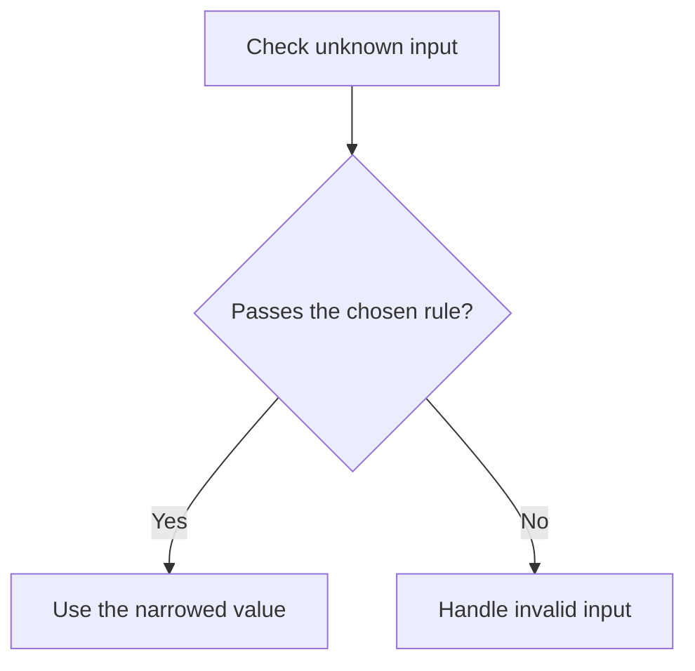
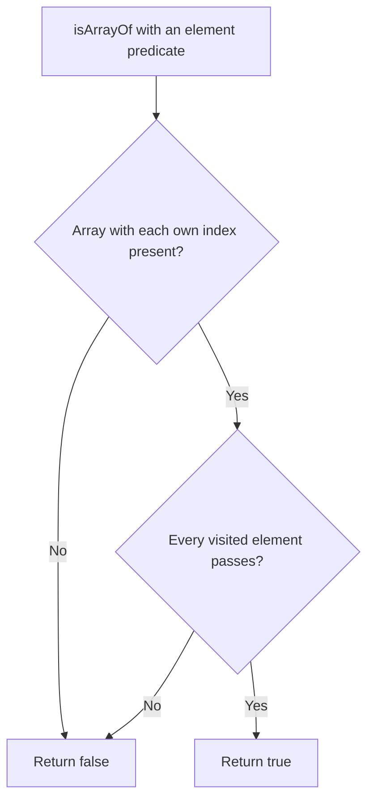

# US-COLUMN-04 — Validate unknown input with reusable JSON predicates

As an application developer, I want to check input before assigning it to a model and reuse that check on hydration so both entry points enforce the same rule.

**Status:** Current.
**Access and entry:** Import the guards from the package root. Direct calls require no Lucid model.

## Acceptance criteria

- `isBoolean` accepts only the primitive values `true` and `false`.
- `isOneOf(values)` snapshots the supplied string and number members. Changing the original list afterwards has no effect. Holes add no member, an empty list accepts nothing and a numeric member never matches its string spelling.
- A fixed tuple of literal members narrows to its union. A dynamic list, a union of alternative tuples, a partially known tuple or a patterned string member only establishes validated membership. Rejection of such a value leaves other values of its underlying type possible.
- `isArrayOf(guard)` accepts an empty array or an array with an own element at every index that passes the guard. A hole, inherited-only index, failing element or non-array returns false. The guard stops at the first failure. Nested predicates apply these rules at each depth.
- A successful array check narrows to the validated dense array type. A failed check leaves ordinary arrays possible. The corresponding JSON column accepts ordinary typed arrays as write inputs and checks them at runtime.
- An application may supply its own `JsonValidator<T>`. Its type predicate supplies the TypeScript narrowing and its implementation decides runtime membership. Exceptions it throws propagate to the caller.

## User flow

## Code flow

The loop checks presence and membership together at each index. [Implementation](../src/json_column.ts) and [runtime and type-level cases](../tests/json_column.spec.ts).
