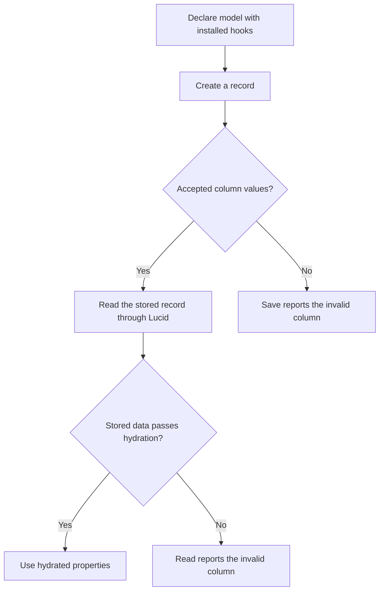

# US-COLUMN-05 — Use the installed package from a typed Lucid model

As an application developer, I want to import the published hooks and types into a Lucid model so my application can typecheck its declarations and read back what it writes.

**Status:** Current.
**Access and entry:** An ESM application using the Node and Lucid versions in the [package manifest](../package.json). Import runtime helpers from `@kevinjohn/adonisjs-lucid-checked-columns` and apply them with Lucid’s `@column`.

## Acceptance criteria

- The root exports runtime helpers and types. The `/types` subpath supports type-only imports of `IsoDate`, `IsoTimestamp`, `IsoColumnOptions`, `JsonColumnOptions` and `JsonValidator`. Both entry points refer to the same declarations and brands.
- A successful ISO predicate check lets the host assign the resulting branded value across either entry point. Hook declarations typecheck their write inputs even when Lucid attribute and model arguments are supplied. `consume` accepts unknown driver input.
- With a configured Lucid adapter and suitable SQLite text columns, creating a record writes JSON text and canonical ISO strings. Finding the record hydrates the array and returns the original ISO strings. No package-specific provider or configuration hook is needed.
- A model save with an invalid date fails. A direct database write can store malformed JSON. The next model read then fails during hydration.

## User flow

## Code flow

The [packed consumer](../examples/release-consumer/model.ts) calls `ReleaseRecord.create`, inspects storage via `db.from` and calls `ReleaseRecord.findOrFail`. Its direct update exercises the corrupt-row branch. The [smoke script](../bin/release_consumer_smoke.sh) installs the tarball into an isolated fixture. [Root exports](../index.ts) and [type entry](../types.ts).
