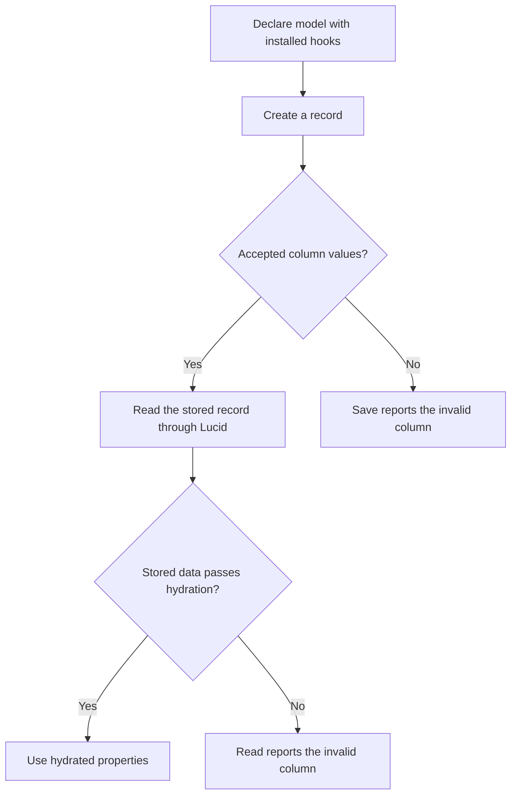
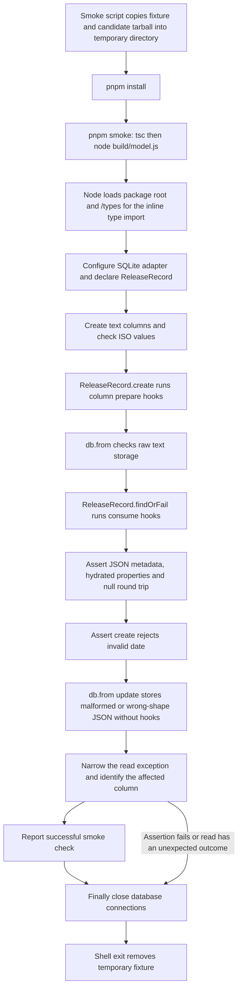

# US-COLUMN-05 — Use the installed package from a typed Lucid model

As an application developer, I want to import the published hooks and types into a Lucid model so my application can typecheck its declarations and read back what it writes.

**Status:** Current in the reviewed source; the installation guide links the v0.4.0 release.
**Access:** An ESM application using the Node, AdonisJS core and Lucid versions in the [package manifest](../package.json).
**Entry:** Install a packaged candidate or the [v0.4.0 release](../README.md#install), then import runtime helpers from `@kevinjohn/adonisjs-lucid-checked-columns` and apply them with Lucid’s `@column`.
**Documentation:** [Install](../README.md#install), [Use](../README.md#use), [API](../README.md#api).
**Source:** [Root exports](../index.ts), [type entry](../src/types.ts), [package manifest](../package.json).
**Coverage:** [Packed consumer](../examples/release-consumer/model.ts), [smoke script](../bin/release_consumer_smoke.sh).

## Acceptance criteria

- The root exports runtime helpers, the `errors` namespace and types. The `/types` subpath supports type-only imports of `IsoDate`, `IsoTimestamp`, `IsoColumnOptions`, `JsonColumnOptions` and `JsonValidator`. Both entry points refer to the same declarations and brands. Since v0.3.2, the subpath also resolves to a JavaScript module with no runtime helpers. It supports inline type specifiers such as `import { type JsonValidator }` when compilation or type stripping preserves an empty module import.
- A successful ISO predicate check lets the host assign the resulting branded value across either entry point. Hook declarations typecheck their write inputs even when Lucid attribute and model arguments are supplied. `consume` accepts unknown driver input.
- The candidate consumer configures a Lucid SQLite adapter and text columns; its create operation writes JSON text and canonical ISO strings. Finding the record hydrates the array and returns the original ISO strings. No package-specific provider or configuration hook is needed.
- A model save with an invalid date throws `errors.E_INVALID_ISO_COLUMN_VALUE`. A direct database write can store malformed JSON or JSON of the wrong shape. The next model read fails during hydration, and the host can narrow the exception to `errors.E_INVALID_PERSISTED_JSON` for the affected table and column. A saved null still hydrates as null.

## User flow

## Code flow

Scope: the smoke script and packed SQLite consumer for a candidate built from this source, including expected refusal cases. Earlier failures also exit through shell cleanup; the consumer closes connections in its finally block once that block has been entered.

The `/types` export selects declarations during typechecking and the default JavaScript module during execution. The [packed consumer](../examples/release-consumer/model.ts) closes the database in `finally` after the model assertions, also on failure. The [smoke script](../bin/release_consumer_smoke.sh) removes the temporary fixture on shell exit.

**Code references:** [packed consumer](../examples/release-consumer/model.ts), [smoke script](../bin/release_consumer_smoke.sh), [smoke command](../examples/release-consumer/package.json), [root exports](../index.ts), [type entry](../src/types.ts), [export map](../package.json#L23).
